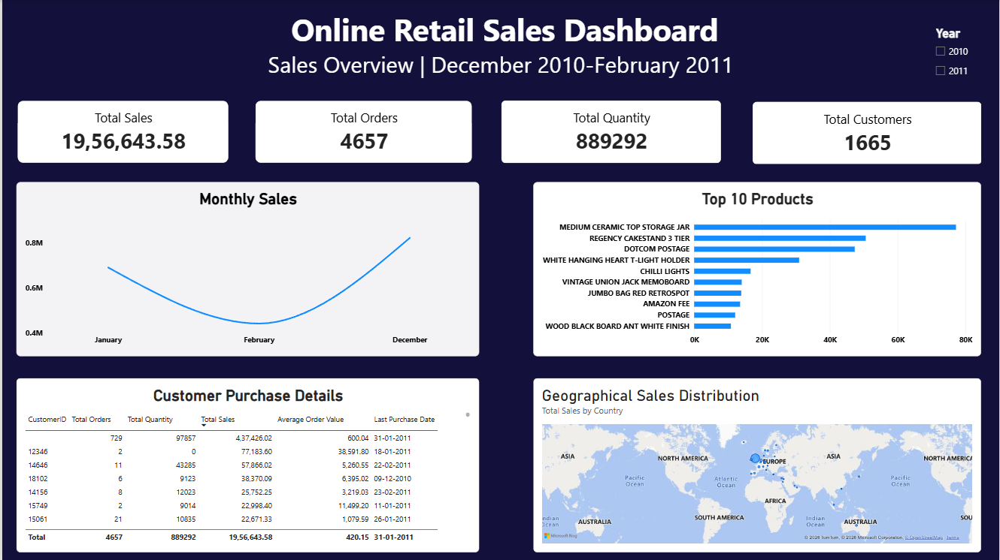
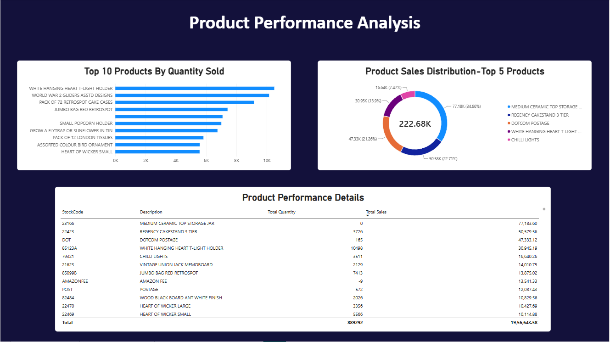
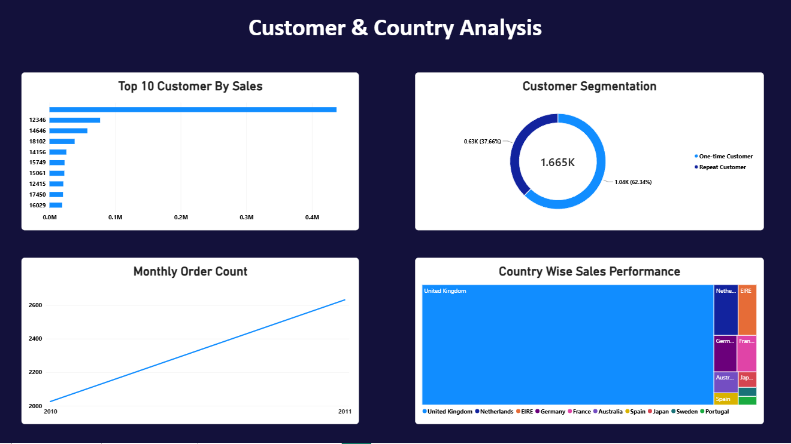

# 🛍️ Retail Sales & Customer Analytics

### 📊 MySQL | Power BI | 

An end-to-end data analytics project focused on retail sales performance, product analysis, and customer purchasing behavior using SQL and Power BI.

---

## 📌 Project Overview

This project analyzes online retail transaction data to understand sales performance, identify high-performing products, compare country-wise sales, and explore customer purchasing patterns.

MySQL was used to query, filter, and analyze transaction data, while Power BI was used to develop interactive dashboards and present key business metrics.

The goal is to transform raw retail data into meaningful insights that support business decision-making.

## 🎯 Business Objectives

- 📈 Analyze overall sales performance and monthly trends.
- 🏆 Identify top-performing products by revenue and quantity sold.
- 🌍 Evaluate sales contribution across countries.
- 👥 Identify high-value customers.
- 💰 Calculate key metrics such as total sales and average order value.
- 🔄 Analyze repeat and one-time customer purchasing behavior.

## 📊 Dashboard Preview

### 1. 💹 Sales Overview

Provides an overview of key sales metrics and retail sales performance.

### 2. 📦 Product Analysis

Highlights top-performing products based on revenue and quantity sold.

### 3. 🌍 Customer & Country Analysis

Explores customer purchasing patterns and compares sales performance across countries.

## 🧮 SQL Analysis

SQL was used to perform the following analyses:

- 🧹 Data validation and transaction filtering
- 💰 Total sales and quantity calculations
- 📅 Monthly sales trends and order analysis
- 🏆 Top 10 products by revenue
- 📦 Top 10 products by quantity sold
- 🌍 Country-wise sales performance
- 👤 Top customers by sales
- 🛒 Average Order Value (AOV)
- 🔄 Repeat and one-time customer analysis
- 📊 Customer and sales contribution analysis

## 🧹 Data Preparation

The transaction data was filtered to ensure meaningful sales calculations.

- Excluded transactions with non-positive quantities.
- Excluded transactions with non-positive unit prices.
- Excluded cancellation invoices beginning with `C`.
- Accounted for missing or blank Customer IDs in customer-level analysis where relevant.

These filters were applied according to the requirements of each analysis.

## 💡 Business Questions

This project explores the following questions:

1. 📈 How does sales performance change over time?
2. 🏆 Which products generate the highest revenue?
3. 📦 Which products sell in the highest quantities?
4. 🌍 Which countries contribute the most to sales?
5. 👥 Which customers generate the highest sales?
6. 💰 What is the average order value?
7. 🔄 How do repeat and one-time customers differ?

## 🗂️ Dataset

The project uses the online retail transaction dataset included in this repository.

The dataset contains transaction-level information, including:

- Invoice number
- Product code and description
- Quantity
- Invoice date
- Unit price
- Customer ID
- Country

## 🛠️ Tools & Technologies

| Tool | Application |
|---|---|
| 🐬 MySQL | Database creation and management |
| 💻 SQL | Data validation, filtering, aggregation, and analysis |
| 📊 Power BI | Interactive dashboards and data visualization |
| 🧮 DAX | KPI and business metric calculations |

## 📁 Project Files

| File | Description |
|---|---|
| `Retail_Sales_Analysis.sql` | SQL queries used for the analysis |
| `Online Retail Analysis.pbix` | Power BI dashboard report |
| `Sales-Overview.png` | Sales overview screenshot |
| `Product-Analysis.png` | Product analysis screenshot |
| `Customer-Country-Analysis.png` | Customer and country analysis screenshot |

## 🚀 Skills Demonstrated

- SQL querying and data aggregation
- Data validation and filtering
- Exploratory data analysis
- Sales and customer analysis
- KPI calculation
- DAX measures
- Power BI dashboard development
- Business-focused data interpretation

## 👩‍💻 Author

**Sruthy S.S.**

🎯 Aspiring Data Analyst

🔗 [GitHub Profile](https://github.com/Sruthy002)
